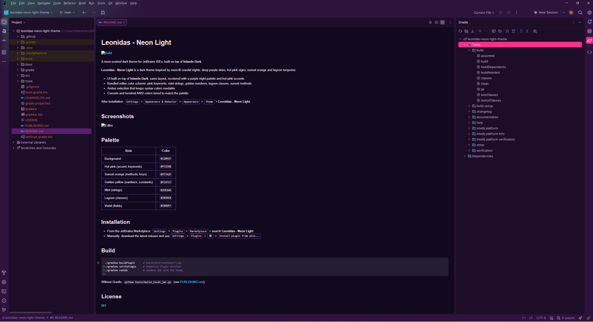
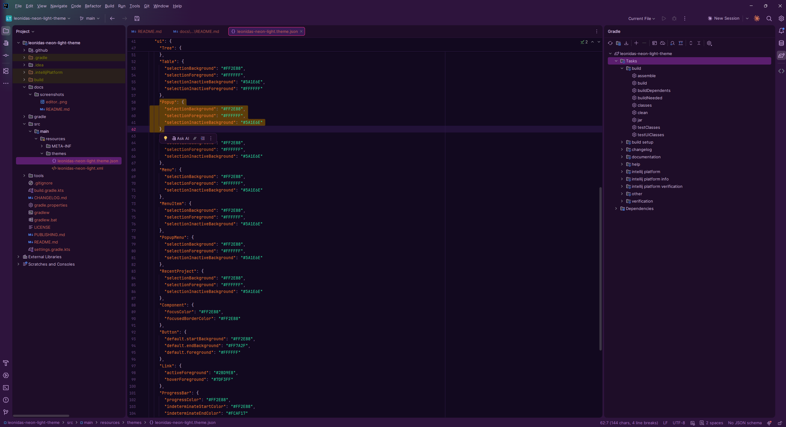
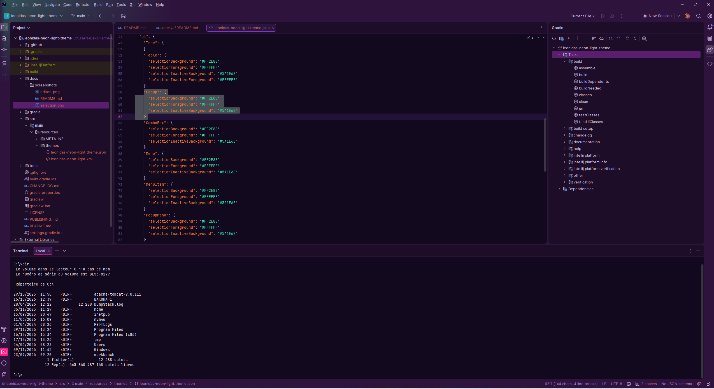

# Leonidas - Neon Light

[](https://github.com/harrylepap/leonidas-neon-light-theme/actions/workflows/build.yml)
<!-- TODO_MARKETPLACE_BADGES : une fois publié, ajouter les badges version / downloads du Marketplace -->

A neon-soaked dark theme for JetBrains IDEs, built on top of **Islands Dark**.

Matching terminal style (Windows Terminal, Starship prompt, eza, Claude Code status line): [leonidas-neon-light-terminal](https://github.com/Harrylepap/leonidas-neon-light-terminal).

<!-- Plugin description -->
**Leonidas - Neon Light** is a dark theme inspired by neon-lit coastal nights: deep purple skies, hot pink signs, sunset orange and lagoon turquoise.

- UI built on top of **Islands Dark**: same layout, recolored with a purple night palette and hot pink accents
- Bundled editor color scheme: pink keywords, mint strings, golden numbers, lagoon classes, sunset methods
- Amber selection that keeps syntax colors readable
- Console and terminal ANSI colors tuned to match the palette

After installation: <kbd>Settings</kbd> &gt; <kbd>Appearance &amp; Behavior</kbd> &gt; <kbd>Appearance</kbd> &gt; <kbd>Theme</kbd> &gt; **Leonidas - Neon Light**.
<!-- Plugin description end -->

## Screenshots







## Palette

| Role | Color |
|---|---|
| Background | `#12091F` |
| Hot pink (accent, keywords) | `#FF2E88` |
| Sunset orange (methods, keys) | `#FF7A2F` |
| Golden yellow (numbers, constants) | `#FCAF17` |
| Mint (strings) | `#2EE6A6` |
| Lagoon (classes) | `#2BD9E8` |
| Violet (fields) | `#C04DFF` |

## Installation

- From the JetBrains Marketplace: <kbd>Settings</kbd> &gt; <kbd>Plugins</kbd> &gt; <kbd>Marketplace</kbd> &gt; search **Leonidas - Neon Light**
- Manually (no Marketplace needed):
  1. Download **`leonidas-neon-light-theme-1.0.0.zip`** from the [latest release](https://github.com/Harrylepap/leonidas-neon-light-theme/releases/latest) (do not extract it).
  2. In the IDE: <kbd>Settings</kbd> &gt; <kbd>Plugins</kbd> &gt; <kbd>⚙️</kbd> &gt; <kbd>Install Plugin from Disk...</kbd> and pick the zip.
  3. Restart, then select the theme in <kbd>Settings</kbd> &gt; <kbd>Appearance</kbd> &gt; <kbd>Theme</kbd>.

## Build

```bash
./gradlew buildPlugin      # build/distributions/*.zip
./gradlew verifyPlugin     # JetBrains Plugin Verifier
./gradlew runIde           # sandbox IDE with the theme
```

Without Gradle: `python tools/build_local_jar.py` (see [PUBLISHING.md](PUBLISHING.md)).

## License

[MIT](LICENSE)
